# Phase 3A Data Layer Architecture

**Status:** Proposed architecture, conditional on provider interface approval. No application source code is changed by this document.

## Architecture decision

Keep the current App Group JSON snapshot as the app/widget boundary. Add a provider-specific remote client and DTO/mapping layer to the **main app target only**. The widget continues to read a validated local `ScheduleSnapshot` through `ScheduleStore`; it performs no HTTP request and knows no provider DTOs. Preserve `MockScheduleFactory` for previews, demos, and deterministic UI/test data.

Do not add a backend or dependency now. A remote provider must first pass the supported-access gate documented in [Phase 3 data source research](PHASE_3_DATA_SOURCE_RESEARCH.md). DTEK is the preferred source if such an interface is confirmed. YASNO's currently verified group API does not satisfy the address-level product semantics.

## Existing abstractions to reuse

- [OutageModels.swift](../OutageSchedule/Shared/Domain/OutageModels.swift): `SelectedAddress`, `ScheduleStatus`, `ScheduleInterval`, `AddressSchedule`, `ScheduleSnapshot`, and `KyivTime` are the internal domain and persisted representation. Keep external provider names and field types out of these models.
- [ScheduleStore.swift](../OutageSchedule/Shared/Storage/ScheduleStore.swift): App Group file location, atomic JSON write, ISO-8601 dates, and schema version check already provide the persistence mechanism. The app owns writes; the widget reads.
- [MockScheduleFactory.swift](../OutageSchedule/Shared/Mock/MockScheduleFactory.swift): retain as the mock data source; do not replace it with network calls or remove existing scenarios.
- [ContentView.swift](../OutageSchedule/App/ContentView.swift): current app owns snapshot restore, save, and `WidgetCenter` reload. Future refresh orchestration belongs in the app layer, not the widget view/timeline.
- [OutageTimelineProvider.swift](../OutageSchedule/Widget/OutageTimelineProvider.swift): reads the shared snapshot and already handles missing, wrong-day, and stale snapshots (currently a 24-hour age cutoff). It remains network-free.

## Proposed components and ownership

| Component | Target/location proposal | Responsibility |
|---|---|---|
| `OutageDataSource` protocol | Shared domain/service code compiled into app target (and only shared by widget if compilation setup requires it; widget must not call it) | Provider-independent async operation to fetch a schedule snapshot for a selected address. Keep the first protocol narrow; avoid generalized multi-provider plugin design. |
| `DTEKOutageDataSource` (name conditional on provider approval) | App target | Coordinates the verified provider lookup flow and yields provider DTO data; no persistence/UI responsibility. If endpoint is unavailable/supported access unconfirmed, do not create it. |
| `OutageAPIClient` | App target | Owns `URLSession`, request construction, timeout, HTTP status/content-type validation, and raw response acquisition. Inject session/base URL for tests. |
| External DTOs | App target | `Decodable` provider wire structures reflecting only observed/official schema. Keep them separate from Codable snapshot domain models. Do not write guessed fields before obtaining a real schema fixture. |
| Validator/mapper | App target, pure Foundation code | Checks address match, supported schedule statuses, date/time zone, interval range/order/coverage, schedule identity, and freshness metadata; maps accepted provider intervals to `.available`, `.outage`, `.possible`, or `.unknown` in existing types. Unsupported semantics fail closed instead of being guessed. |
| Refresh coordinator | App target | Fetch → validate → map → save. Only after successful save, request `WidgetCenter.shared.reloadTimelines(ofKind:)`. On any failure, preserve last-known-good snapshot and expose an app refresh error/state. |
| `ScheduleStore` | Shared app/widget code | Continue encoding/decoding the internal snapshot atomically. The app may use existing `save` Bool result. Consider an error-returning API only if implementation needs to distinguish encoding, missing App Group, and filesystem failures; avoid broad storage refactor. |
| `OutageTimelineProvider` | Widget target | Continue synchronous local read and current stale/missing fallback behavior. Do not make network calls from timeline generation. |

`OutageDataSource` should not return raw JSON or mutate `ScheduleStore`. A simple shape is conceptually `func fetchSchedule(for address: SelectedAddress) async throws -> ScheduleSnapshot`, with provider DTO and validation details contained behind the adapter. The final signature may need a provider identity/selected feed if the confirmed provider requires those values.

## Data flow

```mermaid
flowchart LR
  UI[Main app refresh action / app refresh trigger] --> R[Refresh coordinator]
  R --> P[OutageDataSource]
  P --> C[Remote API client]
  C -->|HTTP response| D[Provider DTO]
  D --> V[Validation]
  V --> M[Mapping to internal ScheduleSnapshot]
  M --> S[ScheduleStore atomic App Group JSON write]
  S -->|save succeeds| W[WidgetCenter timeline reload request]
  W --> T[WidgetKit asks OutageTimelineProvider]
  T --> L[ScheduleStore local read]
  L --> Q[Widget timeline entries and views]
  V -->|reject / stale / invalid| E[App refresh error; retain last-known-good]
  S -->|write failure| E
```

1. The user initiates refresh from the app (or a separately approved app refresh mechanism); the widget never owns the request.
2. The coordinator calls `OutageDataSource` with the persisted/selected address.
3. The adapter/client performs provider-supported address lookup and schedule retrieval. HTTP errors, wrong MIME/body, edge challenge HTML, decoding failures, and timeouts become typed errors.
4. DTO validation confirms the payload is for the requested address, contains one or more identified schedules, has usable day/date/timezone semantics, valid non-overlapping intervals, and acceptable update freshness.
5. Mapping creates the existing `ScheduleSnapshot` model. Provider-specific IDs may be stored as schedule IDs only if stable and non-sensitive; labels remain provider-returned/localized as appropriate. Never manufacture schedule intervals for missing or waiting days.
6. Coordinator saves the whole last-known-good snapshot atomically via `ScheduleStore`. Failed fetch, validation, or persistence must not overwrite a previously valid snapshot.
7. Only after successful persistence does the app call `WidgetCenter.shared.reloadTimelines(ofKind:)`.
8. WidgetKit controls when it runs the provider. Provider reads the snapshot locally, applies its existing date/age checks, and generates a timeline. The reload request is best-effort; it does not guarantee an immediate widget refresh.

## Mapping rules

- Source status semantics must be documented before mapping. Example only: a provider's positively defined “power off” period can map to `.outage`; a positively defined “power on” period can map to `.available`. Do not infer that an absent interval means available unless the provider explicitly defines complete-day coverage.
- Map uncertain/possible periods to `.possible` only when the upstream meaning matches. Unknown, unrecognized, or contradictory statuses reject the new payload or produce `.unknown` only under an explicit product rule; never silently relabel them as available.
- Build `Date` values from provider-local date plus explicit timezone/offset. Use `Europe/Kyiv` only if provider data lacks offsets and official semantics establish that local zone. Validate daylight-saving day length and midnight boundaries.
- Preserve multiple provider schedules for a multi-feed address. Do not select the first result silently; carry `selectedScheduleID` only when user selection is known or the provider explicitly marks one applicable.
- Distinguish `fetchedAt` (client response time) from provider `updatedOn`/effective schedule date. The current domain snapshot has `fetchedAt` but no separate provider-updated timestamp; implementation should decide whether `fetchedAt` remains fetch time and whether a small model/schema change is justified to persist `sourceUpdatedAt` for honest freshness display.
- Current `ScheduleStore.decode` accepts schema version 1 only. Avoid changing the snapshot format unless required by confirmed metadata/selection semantics. If adding source timestamps is necessary, plan a compatible versioned migration and test old fixture behavior.

## Error and freshness behavior

Represent errors by actionable category: unsupported/invalid address, transport timeout/offline, non-success HTTP status, challenged/non-JSON response, decode/schema mismatch, provider no-schedule state, stale provider data, invalid intervals, and App Group persistence failure. UI text can remain concise; retain detailed error type for tests/diagnostics. Do not include full address or raw provider payload in logs.

Freshness must use provider update metadata where available, not just HTTP 200, `Date`, or CDN `max-age`. The Phase 3A YASNO response showed an `updatedOn` nearly 20 hours behind the HTTP response date despite five-minute public cache headers. For DTEK, exact timestamp semantics are unresolved. Set the product stale threshold only after provider cadence is known; preserve existing widget stale handling as a safety net and make the app indicate when it is displaying last-known-good data.

## Main app vs widget boundary

**Main app:** address input/selection, refresh trigger, `URLSession`, provider DTOs, provider validation/mapping, save orchestration, refresh status/errors, and successful-save timeline reload.

**Shared code:** internal Codable schedule models, `ScheduleStore`, `KyivTime`, and mock factory. Only abstractions that compile cleanly for both targets should be placed in shared folders. Provider networking types remain app-only.

**Widget extension:** local snapshot read, age/date validation, timeline generation, and presentation. No network permission, API credentials, provider parsing, address resolver, or refresh coordinator.

## Unresolved architecture decisions

1. Supported DTEK machine endpoint and usage policy (hard implementation gate).
2. Whether address selection is introduced in this phase or an already selected address is supplied; current [ContentView.swift](../OutageSchedule/App/ContentView.swift) only presents demonstration controls.
3. How a user selects among multiple DTEK schedules for a building.
4. Whether to extend `ScheduleSnapshot` with provider update timestamp, provider/source ID, or explicit freshness state; schema migration cost vs useful UI transparency.
5. Product stale cutoff based on provider's actual schedule update behavior.
6. App refresh trigger cadence. iOS background execution is opportunistic; a manual refresh must remain available and should be the initial deterministic mechanism unless a background refresh requirement is approved.
7. The existing `ScheduleStore.save` collapses failure causes into `Bool`; decide whether that is sufficient for user-facing persistence failure handling.
