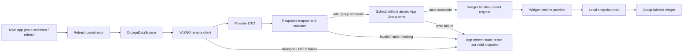

# Phase 3 Data Layer Architecture

**Status:** Approved direction for planning; implementation has not started.
**Provider/product semantics:** YASNO group schedule. Group-level information is not individually verified address data.

## Architecture decision

Preserve the approved boundary:

```text
OutageDataSource -> Remote Client -> Response Mapper -> Existing ScheduleStore -> Widget
```

The main application owns network requests, YASNO response parsing/mapping, refresh orchestration, and App Group writes. The widget remains network-independent and reads the last valid normalized snapshot from `ScheduleStore`. Keep `MockScheduleFactory` for previews/demos and regression coverage. Do not add a backend, authentication, push notifications, multiple-city support, or a second storage system.

Provider-specific networking stays separate from domain mapping. `OutageSchedule` and existing schedule interval/status concepts remain the normalized schedule representation unless implementation proves a specific incompatibility. The current persisted model is address/manual-oriented (`SelectedAddress`, `sourceKind = userEntered`, `AddressSchedule`, `ScheduleSnapshot`) and does not yet represent YASNO group provenance. Add explicit source mode, provider, exact group/subgroup identifier, source `updatedOn`, and local successful `fetchedAt` metadata where appropriate using an additive, backward-compatible schema migration. The persistence design must retain manual and YASNO snapshots independently (or equivalently preserve each mode's data) so mode switching and automatic refresh cannot overwrite manual data. Do not repurpose `SelectedAddress` to hold a YASNO group.

## Existing repository components

- [OutageModels.swift](../OutageSchedule/Shared/Domain/OutageModels.swift): current domain has `SelectedAddress`, `ScheduleStatus`, `ScheduleInterval`, `AddressSchedule`, and `ScheduleSnapshot`. `ScheduleSnapshot` currently stores `fetchedAt`, optional manual `sourceKind`, and optional `lastVerifiedAt`; it has no provider update timestamp or group identity.
- [ScheduleStore.swift](../OutageSchedule/Shared/Storage/ScheduleStore.swift): App Group JSON, atomic writes, ISO-8601 date encoding, and schema-version check. App writes; widget reads.
- [MockScheduleFactory.swift](../OutageSchedule/Shared/Mock/MockScheduleFactory.swift): preserve existing scenarios and do not represent mock values as live YASNO data.
- [ContentView.swift](../OutageSchedule/App/ContentView.swift): currently owns manual/demo snapshot restore/save and widget timeline reload. Future remote refresh belongs in app-side orchestration.
- [OutageTimelineProvider.swift](../OutageSchedule/Widget/OutageTimelineProvider.swift): currently reads local snapshots only and applies date/freshness checks. Keep it offline-only.

These are actual current implementation details, not a claim that YASNO integration already exists.

## Components and ownership

| Component | Target | Responsibility |
|---|---|---|
| `OutageDataSource` | App-side service boundary | Narrow async contract for obtaining validated normalized data for a selected YASNO group. No storage or UI responsibility. |
| YASNO remote client | Main app | `URLSession`, endpoint/request construction, timeout, status and content-type checks, raw response. No domain mapping. |
| YASNO DTOs | Main app | Decode only the observed/fixture-backed wire shape; provider types do not leak into the widget or normalized domain. |
| Response mapper/validator | Main app, pure Foundation where practical | Validate selected group identity, `today`/`tomorrow`, statuses, slots, date/timezone, `updatedOn`, and map supported planned outage semantics into existing normalized schedule types. Fail closed on unsupported or ambiguous data. |
| Refresh coordinator | Main app | Fetch → decode → validate/map → freshness decision → save; expose current/error/stale state; request WidgetKit reload only after successful save. |
| `ScheduleStore` | Shared app/widget | Preserve atomic last-valid snapshot persistence; schema migration only for necessary group identity/provenance/update metadata. |
| `OutageTimelineProvider` | Widget | Read the saved normalized snapshot and evaluate freshness locally; no network, credentials, or YASNO DTOs. |

The selected group is represented by provider identity plus the exact provider group identifier, including subgroup notation such as `19.1`. The user selects the group directly. Derive choices from actual group keys in provider data if supported; validate a selection against available provider data. Do not infer from an address or hardcode a purportedly complete group catalog. Coverage limitations are in [data source research](PHASE_3_DATA_SOURCE_RESEARCH.md).

## Data flow



1. The user selects a group and refreshes in the main app. No network operation occurs in WidgetKit.
2. The coordinator asks `OutageDataSource` for that group. The client executes the verified planned-outages request.
3. DTO decoding and mapping validate that the response contains the requested group and supported day/slot structures. `WaitingForSchedule`, empty/missing data, unknown statuses, or invalid slots never become assumed availability.
4. Mapper output retains provider group identity, provider `updatedOn`, and client fetch time as distinct values. Provider update time must not be replaced by HTTP `Date`, `Cache-Control`, or local fetch time.
5. Only a complete, valid and policy-fresh result replaces the prior valid snapshot. Transport, decoding, validation, freshness, and persistence failures leave last-known-good data intact.
6. After a successful save only, request a WidgetKit timeline reload. WidgetKit decides when it runs; reload is best effort.
7. The widget reads the persisted snapshot, performs local date/freshness checks, and labels the schedule as group-level.

## Domain mapping and identity

- Keep the existing `ScheduleInterval` and `ScheduleStatus` model if observed YASNO meanings map without loss. Do not refactor `OutageSchedule` or broader domain naming without a demonstrated technical need.
- Model group identity separately from address identity. Store region/operator metadata only if necessary to disambiguate the selection and supported by actual provider values; do not assume IDs are permanent.
- Preserve provider `updatedOn` as source update time and local successful retrieval `fetchedAt` separately. Never substitute HTTP `Date`, `Cache-Control`, or `fetchedAt` for `updatedOn`. Add source/provider/group identity fields with an additive schema migration and tests proving existing manual snapshots remain readable and independent.
- Map `Definite`/`NotPlanned` and day status values only according to observed semantics confirmed against fixtures. Do not assume an omitted interval is available. Do not merge the distinct probable-outages endpoint into planned schedules.
- Interpret `start`/`end` as minute offsets only for observed supported payloads; validate range, ordering, day boundary, and timezone. Prefer the explicit offset in provider day dates. Define DST handling from fixture evidence and reject unsupported/ambiguous representations.
- The UI and widget must identify the selected group and state in concise language that the schedule is for a group. Include a persistent, understandable disclaimer such as: “Group schedule; actual outages at your building or apartment may differ.”

## Freshness, errors, and persistence

Use provider `updatedOn` for source freshness and `fetchedAt` for successful local retrieval. Product policy: age through and including 6 hours is CURRENT; greater than 6 and through 12 hours is STALE; greater than 12 hours is STALE with a stronger warning. Missing, malformed, or unusable `updatedOn` is never current, and future timestamps are invalid and rejected. These thresholds are not YASNO guarantees. A stale response does not become a fresh schedule because it was fetched recently. The observed five-minute cache header and roughly 20-hour update lag reinforce that neither HTTP metadata nor local retrieval proves source freshness.

Handle offline/timeout, non-2xx (including 429/5xx), wrong content type, malformed or changed schema, missing group/day, waiting-for-schedule, unknown status/type, invalid intervals/date, stale update time, and App Group write failure. Keep the previous valid snapshot on every failed refresh. Distinguish current schedule, stale last-known-good schedule, waiting for provider schedule, and unavailable/error state. Never claim actual power availability: schedules are planned group data.

## UI semantics

- Group selection is explicit and direct, derived from verified provider data where possible; no address-to-group lookup or address inference is in Phase 3. Do not invent a complete group catalog.
- Manual mode remains user-facing and independently usable alongside YASNO mode. Switching modes/groups must not lose manually entered schedules or overwrite one mode with data from the other.
- Every app and widget presentation of real YASNO data names the group schedule and persistently communicates that an individual building/apartment can differ.
- Demo/mock snapshots must remain visibly demo data and must not be mistaken for current provider data.
- Stale last-known-good data is labeled stale with its provider update time; unavailable data is not replaced with mock or fabricated intervals.

## Build environment note

The prior Ralph iteration reported a malformed SwiftUI `@State` macro-plugin response and unavailable simulator services, with the build failing before successful verification. This report is an unresolved environment/toolchain issue, not evidence of an application source defect. Reassess during approved implementation by retrying a build and recording the exact command/output; do not alter signing, provisioning, unrelated Xcode settings, or source code to hide the failure.

## Out of scope and open items

- DTEK address-specific automatic integration and all investigation/bypass of its edge protection.
- Backend, authentication, push notifications, multiple-city support, and unrelated product features.
- Implementation must resolve provider-data-backed group selector coverage from actual response keys; if unavailable, expose only validated choices and report the limitation without guessing. Exact schema field names and migration mechanics remain implementation details. DTEK availability is not a gate.
